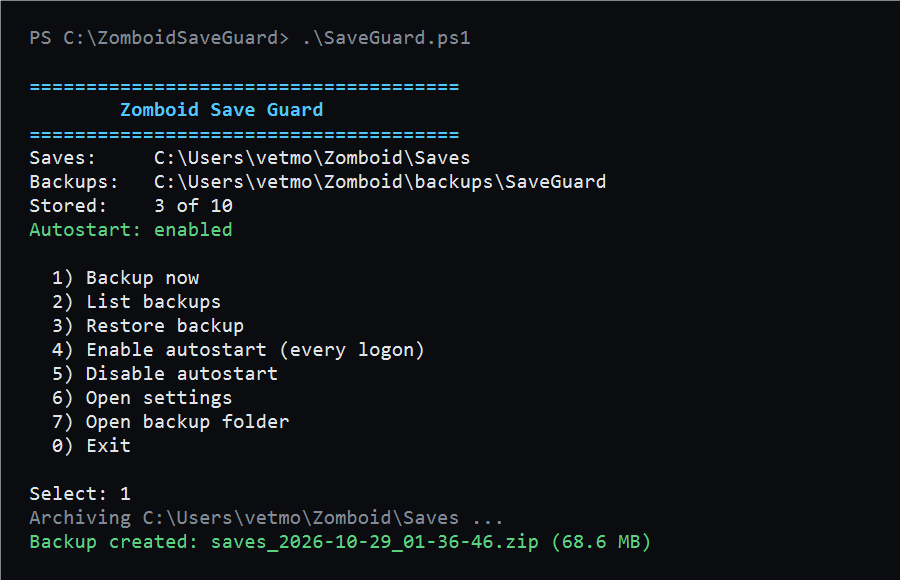

# Zomboid Save Guard



**Automatic backups for Project Zomboid saves on Windows.** A zip snapshot of the whole `Saves` folder at logon, every 2 hours, or on demand — keeps the last 10 copies, one-click restore, no admin rights required.

---

Простая утилита для Windows, которая делает резервные копии сохранений **Project Zomboid** и умеет откатываться на любую из них.

Зачем: B42 и моды регулярно ломают сейвы. Один неудачный мод — и 40 часов игры превращаются в труху. Save Guard делает zip-снимок папки `Saves` при входе в систему (или вручную) и хранит последние N копий.

## Возможности

- Бэкап всей папки `Saves` (все режимы: Sandbox, Survivor, Multiplayer и т.д.)
- Плюс `options.ini` и `latestSave.ini` — чтобы моды и настройки восстанавливались вместе с миром
- Ротация: хранит последние 10 копий, старые удаляет
- Восстановление в один клик: текущие сейвы откладываются в `Saves.before-restore-<дата>`
- Проверка, что игра не запущена, перед восстановлением
- Автозапуск: бэкап при каждом входе в систему (ярлык в папке «Автозагрузка», без прав администратора)
- Лог всех операций в `SaveGuard.log`

## Требования

- Windows 10/11
- Windows PowerShell 5.1 (встроен)

Ставить ничего не нужно: это один `.ps1` файл.

## Запуск

Самый простой способ: **двойной клик по `SaveGuard.bat`** — откроется меню.

Или из PowerShell:

```powershell
cd "путь\к\ZomboidSaveGuard"
powershell -NoProfile -ExecutionPolicy Bypass -File .\SaveGuard.ps1
```

Откроется меню:

```
  1) Backup now
  2) List backups
  3) Restore backup
  4) Enable autostart (every logon)
  5) Disable autostart
  6) Open settings
  7) Open backup folder
  0) Exit
```

Команды без меню (для планировщика и скриптов):

```powershell
.\SaveGuard.ps1 -Action backup
.\SaveGuard.ps1 -Action list
.\SaveGuard.ps1 -Action restore
.\SaveGuard.ps1 -Action enable-autostart
.\SaveGuard.ps1 -Action disable-autostart
```

## Настройки

Файл `config.json` создаётся при первом запуске:

```json
{
  "SavePath": "C:\\Users\\<user>\\Zomboid\\Saves",
  "BackupPath": "C:\\Users\\<user>\\Zomboid\\backups\\SaveGuard",
  "KeepCount": 10,
  "IncludeOptions": true
}
```

- `SavePath` — что бэкапить
- `BackupPath` — куда складывать архивы (можно на другой диск)
- `KeepCount` — сколько копий хранить
- `IncludeOptions` — добавлять ли `options.ini` и `latestSave.ini`

## Восстановление

1. Пункт `3` в меню.
2. Выбери номер копии.
3. Подтверди `y`.

Текущие сейвы не удаляются, а переименовываются в `Saves.before-restore-<дата>` — можно вернуться назад.

**Перед восстановлением закрой игру.** Утилита проверяет это сама, но на всякий случай.

## Как это работает

`Compress-Archive` собирает zip из папки `Saves` и файлов настроек. Имя файла — дата и время: `saves_2026-10-29_20-00-00.zip`. После создания список сортируется по дате, всё сверх `KeepCount` удаляется.

## Ограничения

- `Compress-Archive` не любит архивы больше 2 ГБ. Для сейвов PZ это редкость, но если упрёшься — заменим на 7-Zip.
- Автозапуск работает через папку «Автозагрузка»: бэкап срабатывает при входе в систему, а не по расписанию. Если нужен бэкап каждые N часов — добавь `-Action backup` в Планировщик заданий вручную (потребуются права администратора).
- Утилита не следит за файлами в реальном времени, только по расписанию или вручную.

## Идеи для развития

- Бэкап перед запуском игры (хук на процесс)
- Облако: копирование архива в OneDrive/Google Drive
- GUI на WinForms с треем
- Проверка целостности архива после создания

## Лицензия

MIT — см. `LICENSE`.
